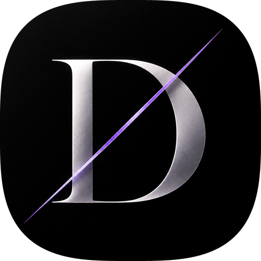

# DEEN

<p align="center">
  
</p>

<p align="center">
  <strong>The Ultimate Anime Streaming Experience. 100% Ad-Free, Pure Entertainment.</strong>
</p>

<p align="center">
  <a href="https://deen.ct.ws/"></a>
  <a href="https://github.com/Deep007h/DEEN/releases/tag/v2.2"></a>
  
  
  
  
</p>

---

## 🌟 Overview

**DEEN** is a modern, high-performance anime streaming application designed specifically for enthusiasts who value aesthetic perfection, extensive catalogs, and a buttery smooth viewing experience. 

Built with an unwavering commitment to quality, DEEN blends a striking dark obsidian user interface with responsive touch controls, instant playback, 120Hz display refresh support, and access to an enormous library of anime titles across all eras. Best of all: **100% Ad-Free with zero interruptions, zero tracking, zero banners, and absolutely no paywalls**.

---

## 🌐 Official Website & Web Portal

Explore our official web portal: **[https://deen.ct.ws/](https://deen.ct.ws/)**

The DEEN official website offers an interactive preview of the application:

- **Interactive 3D App Showcase**: Explore the luxury Obsidian OLED interface across Home, Cinema Player, and Show Hub screens with interactive 3D spatial parallax and dynamic specular glare.
- **Cinema Player Hotspot Tour**: Inspect real-time radar pins detailing touch gestures, multi-language audio (Hindi, English, Japanese, Tamil, Telugu), WebVTT subtitle sync controls, and adaptive 1080p HLS streaming.
- **Direct Web Downloads**: Quick download portal with automatic release detection and architecture switchers for ARM64, ARMv7, and x86_64.
- **Comprehensive FAQ & Guides**: Clear instructions on installing APKs on Android, managing permissions, and selecting the optimal architecture for phones, tablets, and emulators.

---

## 🛡️ 100% Ad-Free Experience

Experience pure, uninterrupted anime streaming without compromises:

- **Zero Ads**: Completely free of all banner ads, interstitial pop-ups, video pre-rolls, and tracking SDKs.
- **No Aggressive Pop-Ups or Spam**: Zero deceptive countdown traps, spam redirects, or commercial interruptions during playback.
- **Clean & Lightweight**: Without background ad networks polling for inventory, enjoy faster loading times, minimal mobile data consumption, and significantly improved battery life.
- **Zero Subscriptions or Hidden Fees**: Every title, season, and quality stream is 100% unlocked and completely free to enjoy.

---

## ✨ Interface & 120Hz Fluid Experience

DEEN was crafted to look and feel like a luxury flagship application:

- **120Hz Hardware Refresh Rate Support**: Automatically unlocks 120Hz/90Hz/144Hz high refresh rate display modes on supported Android devices for silky-smooth 120fps system compositing.
- **Auto-Hiding Top Bar**: Pinned, frosted-glass header with category filter pills that smoothly hides when scrolling down and reappears when scrolling up, with scoped pull-to-refresh.
- **Butter-Smooth Detail Page Transitions**: Zero dropped frames and zero jitter when entering or exiting show detail pages via GPU layer caching and linear flight tweens.
- **Obsidian & Electric Accent Aesthetic**: Designed with deep true-black OLED surfaces accented by electric lime highlights. Optimized for low-light viewing, power efficiency, and minimal eye strain.
- **Frosted Glass Floating Navigation**: Floating pill navigation bar featuring real-time backdrop blur provides intuitive, one-handed navigation across screens.
- **Tactile Micro-Interactions**: Spring-physics interactions, scale animations on button taps, and animated HUD gesture sliders.

---

## 🎬 Cinema-Grade Gesture Video Player

The media player in DEEN offers full control with natural touch gestures and multi-language support:

- **Full-Screen Immersive Landscape**: Automatically locks to widescreen landscape mode for an edge-to-edge cinematic experience.
- **Multi-Language Audio (Hindi, English, Japanese, Tamil, Telugu)**: Instant audio track switching directly within the player HUD, powered by Animelok and MegaVid.
- **Advanced Subtitle Engine**: Crisp on-screen WebVTT subtitles with synchronization delay controls (-5s to +5s) to guarantee voice-to-text timing alignment.
- **Fastest Server Engine**: Intelligent concurrent latency probe that auto-selects the lowest latency stream with real-time badges (⚡ Fastest).
- **Universal Generic Server Numbering**: Streamlined server names (`Server 1`, `Server 2`, `Server 3`) across detail, player HUD, and settings screens.
- **1.5x Hold Speed Gesture**: Long-press hold gesture delivers a smooth 1.5x speed boost with automatic migration from legacy settings.
- **Dedicated Screen Lock**: Floating lock control on top bar and video overlay ensuring zero accidental interruptions during playback.
- **Intuitive Edge Swipes**:
  - **Left Edge (Vertical Swipe)**: Adjust screen brightness on the fly.
  - **Right Edge (Vertical Swipe)**: Adjust media volume with precision on-screen HUD indicators.
- **Quick Seeking**: Double-tap on the left or right side of the screen to jump backward or forward by 10 seconds.
- **Sliding Episode Drawer**: Switch to another episode directly inside the player with a sliding drawer without interrupting full-screen playback.
- **Smart Next Episode Countdown**: An interactive card appears in the final moments of an episode to seamlessly autoplay the next episode.
- **Multi-Quality Streaming**: Switch effortlessly between 360p, 480p, 720p, 1080p, or Auto adaptive resolution based on your network speed.

---

## 🧭 Explore Hub & Discovery

Discover your next favorite anime effortlessly with curated discovery feeds:

- **Trending Spotlights**: Dynamically updated spotlight billboard showcasing top weekly series.
- **Curated Seasonal Collections**: Explore currently airing seasonal anime, top-rated anime classics, and hidden gems organized by community popularity.
- **Intelligent Title Matching**: High-confidence fuzzy string matching across multiple global providers and Asian drama indexers.

---

## 📚 Vast & Comprehensive Anime Library

Discover, explore, and track an expansive world of animation:

- **Endless Catalog Across All Genres**: Browse thousands of titles spanning timeless classics, weekly seasonal broadcast releases, feature-length movies, and exclusive OVAs.
- **Franchise & Season Chains**: Explore complex universes effortlessly. DEEN maps out full prequel, sequel, and spin-off timelines with dedicated, interactive season tabs.
- **Rich Show Details**: Get comprehensive information on every title, including synopsis, episodic guides, original and localized titles, studio information, premiere dates, and community ratings.
- **Smart Search & Filters**: Quickly locate any anime by keyword, or filter by popularity, highest ratings, and trending tags.

---

## 📑 Library Management, Downloads & Tracking

Keep your anime journey organized effortlessly:

- **Offline Episode Downloads**: Full download management with progress tracking and offline playback.
- **Personalized Watchlist (Following)**: Follow your favorite series with a single tap. Visual badges alert you to unwatched episodes as they release.
- **Resume Playback**: Pick up exactly where you left off with accurate episode timestamp tracking across all titles.
- **Detailed Watch History**: Chronological playback history with visual progress indicators and swipe management.
- **Local Data Backup & Restore**: Safeguard your watchlist and watch history with easy export and import capabilities.

---

## 📥 Download & Installation

The latest 100% Ad-Free release APKs are hosted directly under [GitHub Releases v2.2](https://github.com/Deep007h/DEEN/releases/tag/v2.2) and can also be downloaded from our official website at **[deen.ct.ws](https://deen.ct.ws/)**.

### Available Downloads (v2.2 — 100% Ad-Free Edition)

| Package Architecture | File Name | Recommended For | Direct Download |
| :--- | :--- | :--- | :--- |
| **ARM64 (64-bit)** | `app-arm64-v8a-release.apk` | Most modern Android smartphones & tablets | [Download APK](https://github.com/Deep007h/DEEN/releases/download/v2.2/app-arm64-v8a-release.apk) |
| **ARMv7 (32-bit)** | `app-armeabi-v7a-release.apk` | Older Android phones & legacy devices | [Download APK](https://github.com/Deep007h/DEEN/releases/download/v2.2/app-armeabi-v7a-release.apk) |
| **x86_64** | `app-x86_64-release.apk` | Android Emulators (BlueStacks, LDPlayer), Chromebooks & PC | [Download APK](https://github.com/Deep007h/DEEN/releases/download/v2.2/app-x86_64-release.apk) |

> **Tip**: If you are unsure which version to pick, download **`app-arm64-v8a-release.apk`** (recommended for almost all modern Android devices).

---

### Step-by-Step Installation Guide

1. **Download the APK**: Choose the APK corresponding to your device architecture from the table above, the [Releases](https://github.com/Deep007h/DEEN/releases/tag/v2.2) section, or the official website [deen.ct.ws](https://deen.ct.ws/).
2. **Allow Installation**:
   - If prompted by your browser or file manager, open **Settings** > **Security** (or **Install unknown apps**).
   - Toggle **Allow from this source**.
3. **Install the App**: Tap the downloaded `.apk` file and select **Install**.
4. **Launch & Stream**: Open **DEEN** from your app drawer and enjoy unlimited, ad-free anime streaming!

---

### File Integrity (SHA-256 Checksums)

Verify the authenticity of your downloaded package:

```text
app-arm64-v8a-release.apk:
8a0b6fac736944e5f67a14104cd287d8937c3a4388f3b5e6d598ac8f5fe2071b

app-armeabi-v7a-release.apk:
738b45d4ab9be4ae8204fd1b369c5cc8d2c93e6992e833a32d8401d088eeb145

app-x86_64-release.apk:
c28988ebb3f6ed7923bae276200d8939ddaa9a34864f6cb45f5fae6d8182685c
```

---

## 📱 System Requirements

- **Operating System**: Android 5.0 (Lollipop, API Level 21) or higher
- **Internet**: High-speed connection recommended for 1080p high-definition playback
- **Permissions**: Network access (Internet / Access Network State)

---

## ⚖️ Disclaimer

DEEN is an application intended for personal media streaming and library tracking. DEEN does not host, upload, or own any video media directly on any servers. All content and metadata are retrieved via external third-party public directories and indexers. All trademarks, copyrights, and intellectual property belong to their respective creators and licensors.
