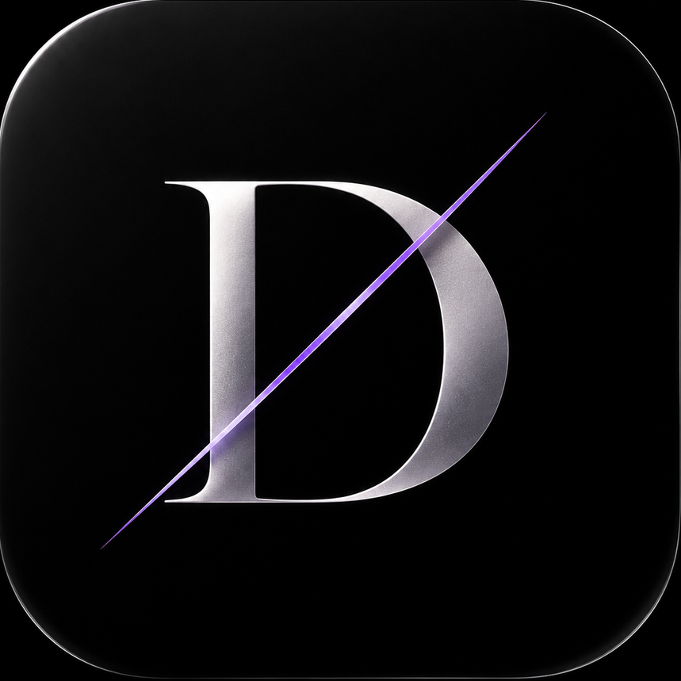

# DEEN

<p align="center">
  
</p>

<p align="center">
  <strong>The Ultimate Ad-Free Anime Streaming Experience. Pure Entertainment, Uninterrupted.</strong>
</p>

<p align="center">
  <a href="https://github.com/Deep007h/DEEN/releases/latest"></a>
  
  
  
</p>

---

## 🌟 Overview

**DEEN** is a modern, high-performance anime streaming application designed specifically for enthusiasts who value aesthetic perfection, extensive catalogs, and an uninterrupted viewing experience. 

Built with an unwavering commitment to quality, DEEN blends a striking dark obsidian user interface with responsive touch controls, instant playback, and access to an enormous library of anime titles across all eras. Best of all: **zero advertisements, zero interruptions, and no paywalls**.

---

## ✨ Interface & Visual Experience

DEEN was crafted to look and feel like a luxury flagship application:

- **Obsidian & Crimson Aesthetic**: Designed with deep true-black OLED surfaces accented by bold crimson highlights. The interface is optimized to look stunning in low light while minimizing battery consumption and eye strain.
- **Frosted Glass Floating Navigation**: A modern, floating pill navigation bar featuring real-time backdrop blur provides intuitive, one-handed navigation across screens.
- **Fluid Micro-Animations**: Smooth spring-physics interactions, reactive touch feedback, and fluid hero poster transitions deliver a responsive, tactile feel throughout the app.
- **Content-First Presentation**: Clutter-free cards, high-resolution cover artwork, and immersive widescreen backdrops put the spotlight directly on your favorite anime.

---

## 📚 Vast & Comprehensive Anime Library

Discover, explore, and track an expansive world of animation:

- **Endless Catalog Across All Genres**: Browse thousands of titles spanning timeless classics, weekly seasonal broadcast releases, feature-length movies, and exclusive OVAs.
- **Franchise & Season Chains**: Explore complex universes effortlessly. DEEN maps out full prequel, sequel, and spin-off timelines with dedicated, interactive season tabs.
- **Rich Show Details**: Get comprehensive information on every title, including synopsis, episodic guides, original and localized titles, studio information, premiere dates, and community ratings.
- **Smart Search & Filters**: Quickly locate any anime by keyword, or filter by popularity, highest ratings, and trending tags to discover your next favorite series.

---

## 🚫 100% Ad-Free & Pure Entertainment

Say goodbye to frustrating streaming hindrances:

- **No Pop-Ups, No Video Ads**: Stream directly into content without waiting for countdowns, interstitial banners, or sponsor breaks.
- **No Subscriptions or Hidden Fees**: Every title, season, and quality stream is fully unlocked and completely free to enjoy.
- **Instant Playback**: Fast loading times and a streamlined UI ensure you spend your time watching, not waiting.

---

## 🎬 Cinema-Grade Gesture Video Player

The media player in DEEN offers full control with natural touch gestures:

- **Full-Screen Immersive Landscape**: Automatically locks to widescreen landscape mode for an edge-to-edge cinematic experience.
- **Intuitive Edge Swipes**:
  - **Left Edge (Vertical Swipe)**: Adjust screen brightness on the fly.
  - **Right Edge (Vertical Swipe)**: Adjust media volume with precision on-screen HUD indicators.
- **Quick Seeking**: Double-tap on the left or right side of the screen to jump backward or forward by 10 seconds.
- **Instant 2x Playback Boost**: Long-press anywhere on the video screen to temporarily boost playback speed to 2x.
- **Sliding Episode Drawer**: Switch to another episode directly inside the player with a sliding drawer without interrupting full-screen playback.
- **Smart Next Episode Countdown**: An interactive card appears in the final moments of an episode to seamlessly autoplay the next episode.
- **Multi-Track Audio & Subtitles**: Easily switch between original Japanese audio, dubbed versions, and multi-language subtitles.
- **Multi-Quality Streaming**: Switch effortlessly between 360p, 480p, 720p, 1080p, or Auto adaptive resolution based on your network speed.

---

## 📑 Library Management & Tracking

Keep your anime journey organized effortlessly:

- **Personalized Watchlist (Following)**: Follow your favorite series with a single tap. Visual badges alert you to unwatched episodes as they release.
- **Resume Playback**: Pick up exactly where you left off with accurate episode timestamp tracking across all titles.
- **Detailed Watch History**: Chronological playback history with visual progress indicators and swipe management.
- **Local Data Backup & Restore**: Safeguard your watchlist and watch history with easy export and import capabilities.

---

## 📥 Download & Installation

The latest release APKs are hosted directly under [GitHub Releases](https://github.com/Deep007h/DEEN/releases/latest).

### Available Downloads

| Package Architecture | File Name | Recommended For | Direct Download |
| :--- | :--- | :--- | :--- |
| **ARM64 (64-bit)** | `DEEN-v1.0.0-arm64-v8a.apk` | Most modern Android smartphones & tablets | [Download APK](https://github.com/Deep007h/DEEN/releases/download/v1.0.0/DEEN-v1.0.0-arm64-v8a.apk) |
| **ARMv7 (32-bit)** | `DEEN-v1.0.0-armeabi-v7a.apk` | Older Android phones & legacy devices | [Download APK](https://github.com/Deep007h/DEEN/releases/download/v1.0.0/DEEN-v1.0.0-armeabi-v7a.apk) |
| **x86_64** | `DEEN-v1.0.0-x86_64.apk` | Android Emulators (BlueStacks, LDPlayer), Chromebooks & PC | [Download APK](https://github.com/Deep007h/DEEN/releases/download/v1.0.0/DEEN-v1.0.0-x86_64.apk) |

> **Tip**: If you are unsure which version to pick, download **`DEEN-v1.0.0-arm64-v8a.apk`**, as nearly all modern Android smartphones use 64-bit ARM processors.

---

### Step-by-Step Installation Guide

1. **Download the APK**: Choose the APK corresponding to your device architecture from the table above or the [Releases](https://github.com/Deep007h/DEEN/releases/latest) section.
2. **Allow Installation**:
   - If prompted by your browser or file manager, open **Settings** > **Security** (or **Install unknown apps**).
   - Toggle **Allow from this source**.
3. **Install the App**: Tap the downloaded `.apk` file and select **Install**.
4. **Launch & Stream**: Open **DEEN** from your app drawer and enjoy unlimited anime streaming!

---

### File Integrity (SHA-256 Checksums)

Verify the authenticity of your downloaded package:

```text
DEEN-v1.0.0-arm64-v8a.apk:
4f787f2fce128258b8dfd584675e25ce57e424c2fb5b07a6b1298045d135fd77

DEEN-v1.0.0-armeabi-v7a.apk:
4301b94960d76c6f817639623cdfa78dfc836c94aa2f9b9d83843a542243bfc1

DEEN-v1.0.0-x86_64.apk:
71ca6270c103f2ae31656bf1f6e781a7143093e0eee4aede4bb292fd43777f94
```

---

## 📱 System Requirements

- **Operating System**: Android 5.0 (Lollipop, API Level 21) or higher
- **Internet**: High-speed connection recommended for 1080p high-definition playback
- **Permissions**: Network access (Internet / Access Network State)

---

## ⚖️ Disclaimer

DEEN is an application intended for personal media streaming and library tracking. DEEN does not host, upload, or own any video media directly on any servers. All content and metadata are retrieved via external third-party public directories and indexers. All trademarks, copyrights, and intellectual property belong to their respective creators and licensors.
